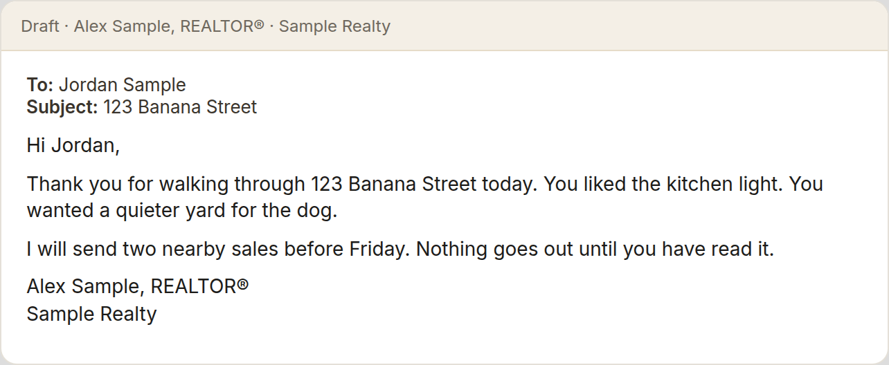
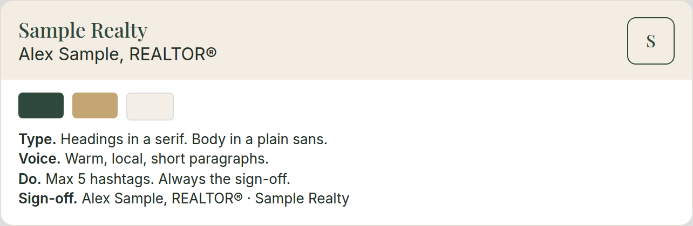
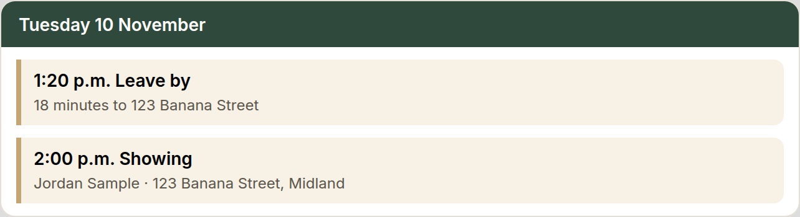
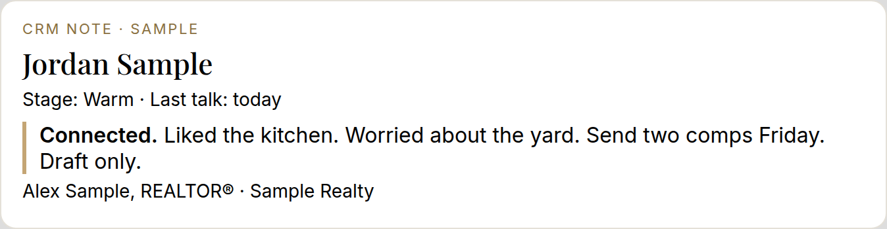
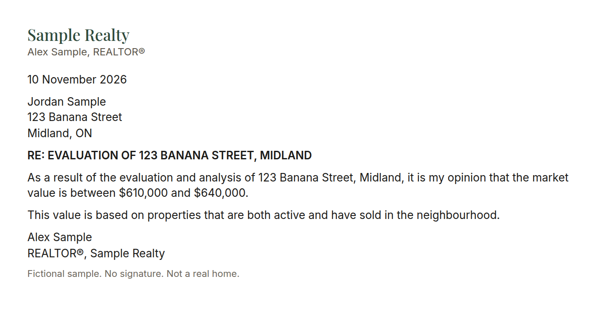
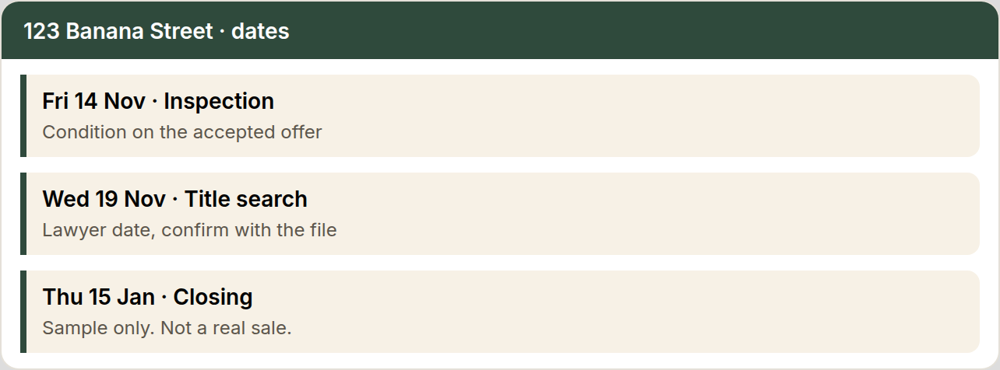
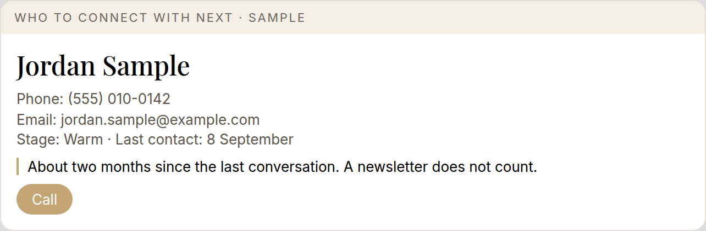

# Step 1 of 4: Getting Started

From Jonathan Wallace, REALTOR®, Faris Team Real Estate Brokerage.

For the team talk on Tuesday, November 10, 2026. This file is Step 1 only: one assistant, used every day, by chat.

It covers the everyday jobs, a Letter of Opinion, a deal card, a one-page brand guide, and local posts you write yourself. It does not cover ads or a full nurture campaign. It does not cover connecting accounts or a team of assistants. Those are later steps, named below and not taught here.

Ground rule: AI drafts. You decide. You send.

How to use this file: paste it into the one assistant you chose, then ask it to coach you through the first week below. Keep every client message as a draft until you have read it.

## The four steps

1. **Getting Started.** One assistant, used every day. This file.
2. **Connect Your Tools.** Email, calendar, CRM and Drive. Not in this file.
3. **Teach It Your Way.** Your standards, voice and processes. Not in this file.
4. **Build Your AI Team.** Specialized assistants working alongside you. Not in this file.

---

## 1. How to start

Use Grok or Claude, and open it every day. Grok is the top pick for agents.

Three moves, from the beginner level:

1. **One task you hate.** Pick one low-value task you put off, and use the chat for that one thing.
2. **Write your rules down.** A short note: your name, brokerage, and area; how you write; words you never use; and "drafts only, I send." Paste it at the start of the chat.
3. **Drafts only.** It drafts. You review. You send. When you correct it, keep that correction as a one-line rule.

### This week

- Create a free account and install the phone app, so you can use voice.
- Write the rules note.
- Use the chat for that one task on 3 or more days.
- Dictate between appointments while you are parked. Never while driving.

### Rules note (copy, then personalize)

```
I'm a REALTOR® with Faris Team Real Estate Brokerage. I work in [your area].

Voice: warm, short, plain language. No exclamation marks. No em dashes.
Greeting and sign-off: [how you normally write].
Words I do not use: [your list].

Drafts only. I review every word and I send it myself. Never send, post, or text a client on your own.
Flag anything I need to verify. Do not invent prices, dates, school facts, or legal conclusions.
If something should be confirmed with the brokerage, say so.
This is not legal advice.
```

### First prompts to try

Copy one prompt into a new chat. Paste your rules note first. These are samples. Do not paste client ID, banking, or mortgage numbers.

**Time-blocked day plan**

```
I'm a REALTOR®. Here is my messy list for today. SAMPLE DATA ONLY.

3 showings, 2 callbacks, an offer to review, and a client gift to order.

Give me a time-blocked plan with the income tasks first. Flag anything I should confirm with my brokerage. Do not invent client names or appointment times.
```

**Closing-week checklist**

```
Give me a closing-week checklist for a sample freehold purchase. Mark anything legal as confirm with the brokerage. This is sample data, not a real file. Do not invent dates, names, or figures.
```

**Post-showing follow-up**

```
I'm a REALTOR® in Midland, Ontario. Here are my messy notes from a showing today. SAMPLE DATA ONLY.

Buyers: Alex and Jordan Sample. Saw 123 Maple Sample St. Loved the kitchen and the walk to the waterfront trail. Worried the yard is small for their dog. Asked about school bus routes and what similar homes sold for. They're pre-approved, want to decide in 2 weeks.

Please give me:
1. A short, friendly follow-up email I can send tonight (under 120 words, no em dashes, no exclamation marks).
2. Three questions to ask them on our next call.
3. A to-do list for me before that call, marking anything I need to verify myself.
Do not invent sale prices or school facts. Say "verify" where I need to check.
```

123 Maple Sample St is not a real listing. Alex and Jordan Sample are fictional.

**Buyer consultation prep**

```
Build me a one-page prep sheet for a first buyer consultation with a sample couple relocating to Midland. SAMPLE DATA ONLY.

Include questions I should ask, a showing-day checklist, and what I must verify myself. Do not invent neighbourhood facts, school facts, or prices.
```

**Summarize a long note**

```
Summarize the notes below. SAMPLE DATA ONLY. Give me key points, risks, and questions to ask. Tell me what to verify against the original. Do not add facts that are not in the notes.

[Paste the notes here. Remove private client identifiers first.]
```

**Plain-language explainer**

```
Explain, in plain language a buyer can follow, what a home inspection condition means. I am a REALTOR® in Ontario. Keep it short. Flag anything I should confirm. This is general education, not legal advice. Do not invent rules.
```

Talk to it like an assistant. Give it who it is for, what happened, and what you want back. Correct it once. Do not spend the week polishing the wording of the prompt.

---

## 2. Where to focus your efforts

Stay in the chat. These are the jobs worth your first month. None of them replace you with a client.

1. **Everyday admin and organizing your day.** Hand it the messy list. Ask for a time-blocked plan with the income tasks first.
2. **Emails, texts, and follow-up.** Post-showing thank-you, a check-in with a past client, a "still looking?" text. For most agents, this is how you serve the people you already have.
3. **Summaries.** A long email, condo status certificate notes, or call notes. Ask for key points, risks, and questions, then check the original.
4. **Appointment prep and buyer research.** A one-page prep sheet. Neighbourhood questions, a showing-day checklist, and a plain-language explainer. Verify every fact. Property search stays in MLS.

Copy the finished draft into the tool you already use. You hit send.

One worked example is the Faris Team Letter of Opinion. In Jonathan's experience, about 30 minutes by hand, about 30 minutes to set up once, then about 30 minutes back on each letter. The steps and the instruction file are in the [Letter of Opinion kit](loo-kit.html). Download the Word template from the shared folder named in that kit, add your own signature photo, and give your AI the template, the photo, and the kit.

What's possible on a call: a recorder such as Plaud can clip to the phone. The app makes a transcript and a summary, and your AI can turn that into a CRM note, the tasks, and a follow-up email. That is advanced. You do not need one to start, and it is not in the 30-day plan.

The version to do this month is free. After an appointment, record a voice memo, or talk through how it went. Let people know you are recording. Ask for the same three things:

```
Here is my voice memo, or my spoken recap, from a call with [client].

Give me:
1. A 3-line CRM note
2. A follow-up task list with dates
3. A short follow-up email recapping what they told me and the next step

No em dashes. Flag anything I need to verify. Do not invent details.
```

Your next call can be one card at a time, read from the Follow Up Boss website. You sign in yourself. The AI never needs your password. The steps are in the [Deal Card kit](deal-card-kit.html).

A one-page brand guide starts with Share with your AI. Share 10 social media posts you like the style of, so it understands your taste, alongside fonts, colour palettes, designs, and your logo. Screenshots are fine. Then upload your photos, headshots, and listing photos to one Drive folder: Headshots, Listing Photos, Local Spots, and Logo. Only share that one folder with your AI, not your whole Drive. Then it builds the guide. Edit the guide until it sounds like you, save one file, and say "follow my brand guide" each time you ask for a post.

```
Here are 10 social media posts I like the style of, so you understand my taste, plus fonts, colour palettes, and designs I like, and my logo. My photos, headshots, and listing photos are in one Drive folder: Headshots, Listing Photos, Local Spots, and Logo. Use only that folder, not my whole Drive.

Build me a one-page brand guide: colours with hex codes, a heading and body font, photo style, voice, dos and don'ts, max 5 hashtags, my sign-off line. Ask me questions if anything is unclear.
```

At the end of each chat, save your SOPs and the decisions you made. Before you close, ask your AI to write up any new step-by-step (an SOP) and any decisions or rules you agreed on. Save them to your house rules file, or to an SOP doc in your one Drive folder, so the next chat starts smarter.

```
Before we finish, list any new SOPs and decisions from this chat in short bullet points so I can save them to my rules file.
```

On day 1, ask it to help you pick the work:

```
I'm a real estate agent. Ask me a few questions about my week, then help me pick three tasks I hate doing that you could help me with over the next 30 days. For each, tell me how we'd start and how much time it could save.
```

A sample answer, not yours: paperwork follow-up, CMA prep, writing listing descriptions.

---

## 3. The cost

You can start for $0. Every tool below has a free tier that is enough to learn the habit.

Jonathan's takeaway for the team: for about $50 to $100 a month you will have all the tools you need. That is a budget for the tools, not a quote for one specific plan, and it is not anyone's personal bill.

Published prices as of Nov 9, 2026, before tax. Prices change. A promo price is marked. Where the page did not name a currency, the table says so.

### Grok

Plan names are Plus, Premium, Super, and Ultra.

| Plan | Published price | Notes |
|---|---|---|
| Free | $0 / month | Limited. The US pricing page shows this in US dollars. |
| Plus | CA$9.99 / month | Canadian plans page. The US page lists Plus at $8 / month. |
| Premium | CA$41.99 / month | Canadian plans page. First month promo CA$21. The US page lists Premium at $30 / month and calls it the plan for new AI users. |
| Super | CA$139.99 / month | Canadian plans page. Half off the first month. The US page lists Super at $100 / month. |
| Ultra | CA$279.99 / month | Canadian plans page. Half off the first month. The US page lists Ultra at $200 / month. |
| Teams | US$30+ / user / month | No Canadian dollar price was published on the page we checked. |

The Canadian annual toggle for Plus did not look reliable, so these are monthly prices only.

### ChatGPT

| Plan | Published price | Notes |
|---|---|---|
| Free | CA$0 / month | Limited uploads, voice, and deep research. |
| Go | CA$11 / month | The page says this plan may include ads. |
| Plus | CA$25 / month | Includes projects, scheduled tasks, and custom GPTs. |
| Pro | From CA$136 / month | Power users. Not needed to start. |
| Business | CA$34 / seat / month | Standard seat, billed monthly. CA$27 / seat / month if billed annually. The page says business data is not used for training by default. |

### Claude

These amounts were shown to a Canadian browser session with no currency label. The US view of the same page was lower ($20 / month for Pro, billed monthly), so the figures below are most likely Canadian dollars. That was not printed on the page.

| Plan | Amount shown | Notes |
|---|---|---|
| Free | $0 | Limited usage. |
| Pro | $28 / month | Or $23 / month if billed annually ($280 up front). |
| Max | $140 / month | Higher usage. Not needed to start. |
| Ultra | $280 / month | Higher usage. Not needed to start. |
| Team | $35 / seat / month | Standard seat, billed monthly. $28 / seat if billed annually. Same currency caveat. |

### Google Gemini

| Plan | Published price | Notes |
|---|---|---|
| Free | CA$0 / month | With a Google account. |
| Google AI Plus | CA$6.99 / month | Includes Gemini in Gmail and 400 GB storage. |
| Google AI Pro | CA$26.99 / month | Includes Gemini in Gmail, Docs, and more, plus 5 TB storage. |
| Google AI Ultra | From CA$139.99 / month | A higher tier is listed at CA$279.99 / month. Not needed to start. |
| Business | From US$21 / seat / month | Gemini Enterprise Business edition. No Canadian dollar price was shown. |

### Microsoft Copilot

| Plan | Published price | Notes |
|---|---|---|
| Free Copilot chat | Free | A free chat entry was linked from the pricing page. The limits were not confirmed in this check. |
| Microsoft 365 Personal (includes Copilot) | CAD $11.50 / month | Or CAD $115 / year. A 1-month free trial was offered. |
| Microsoft 365 Premium | CAD $27 / month | Or CAD $270 / year. Described as having advanced Copilot features. |
| Microsoft 365 Copilot Business | CAD $34.20 / user / month | Add-on to a business Microsoft 365 plan. CAD $28.50 annually. A promo was shown from CAD $24.43. Only relevant if the team's email already runs on business Microsoft 365. |

### A simple path

Weeks 1 and 2: stay on a free tier.

Week 3: if you are using it every day and hitting limits, pay for one plan. Everyday individual plans published on Nov 9, 2026 include ChatGPT Plus at CA$25, Google AI Pro at CA$26.99, Claude Pro at $28 with the currency caveat above, and Grok Premium at CA$41.99. Microsoft 365 Personal with Copilot is CAD $11.50 if you also want the Office apps.

Review the choice after 30 days.

### Example time math (not a measured result)

This is an example only. It is not a study and it is not your number.

- Suppose AI saves 20 minutes on a workday of follow-ups and admin.
- Over 20 workdays that is 400 minutes, which is about 7 hours a month.
- At a sample value of $50 an hour for your time, about 7 hours is about $350.
- Set that beside one paid plan of about $25 to $42 a month.

Track your own minutes for two weeks. Decide with your own number.

---


---

## 4. What not to waste time with

Advice for the first month. Not a study.

- Don't subscribe to every tool. Pick one and learn it.
- Don't chase every new app or announcement.
- Don't spend hours perfecting prompts. Talk to it like an assistant, then correct it.
- Don't build complex automations or custom bots on day one. The beginner playbook says to skip building too big, too fast, and lots of scheduled automations. They get messy. Output beats infrastructure.
- Don't let it send anything to a client before you have read it. No auto replies. No blasts you have not read.
- Don't trust it for MLS facts, prices, or legal and contract wording without checking. Check prices, dates, addresses, and legal wording yourself, every time.
- Don't paste private client information (financials, ID, passwords) into a tool you have not set up with your rules.

Connecting accounts, saving a standing process, and adding more assistants are later steps. They are not this month's work.

---

## Your next 30 days

Do one day at a time. If you don't finish a day's task, don't move on until it's done. If 30 days takes you 90, that's okay.

Days 1 to 9 are about 15 to 20 minutes. Days 10 to 20 are about 30 minutes. Days 21 to 30 are about 30 to 45 minutes. Days 7, 16, and 24 are good spots to catch up. Each person's Day 1 starts when they first sign in.

Eight parts: Foundations (days 1 to 7), Clients and social (8 to 10), Connect your tools (11 to 14), Letters and offers (15 to 18), Deal card (19 to 21), Advanced (22 and 23), Your list (24 to 29), Review (30).

From Day 6 on, end every day by adding decisions to your decision log. Use Grok or Claude. Grok is the top pick for agents.

Your 30 days also live in an online learning centre where you sign in with your name and tick off each day.

Examples, where a picture helps, are Sample Realty, Alex Sample, REALTOR®, and 123 Banana Street. Not a real home.

The same list is on the playbook download page, where you can tick each day off and this phone remembers it.

### Foundations

## Day 1. Pick your AI and tell it about your business

Foundations · 15 to 20 min

It can only help with a business it understands.

1. Pick one AI. My picks are Grok or Claude, and I think Grok is the easiest to use for real estate agents.
2. Install it on your phone and your computer.
3. Explain your business: who you are, your experience, and everything it would need to know to help you. Examples: how many houses you have sold, what areas you like to work in, and the roadblocks and challenges where it could help you manage, fix, solve or add leverage.
4. Ask it to save what you set up today.

**Done when:** It can play back a short summary of your business and you are happy it is accurate.

**Prompt**

```
I'm a REALTOR® and I want you to understand my business. Ask me questions one at a time: how many houses I've sold, what areas I like to work in, how long I've been in real estate, and the roadblocks and challenges where you could help me manage, fix, solve or add leverage. When we're done, give me a short summary of my business and save it.
```

## Day 2. Teach it your writing style

Foundations · 15 to 20 min

What you feed it is what it writes like.

1. Give it samples of writing you like (emails you have sent, authors, articles) and what you do not want (for example em dashes, long paragraphs).
2. Ask it to make up a mock scenario and draft an email to one of your clients.
3. Send it to yourself, or load it as a draft in Outlook or Gmail, so you see exactly how it writes.
4. Coach it and adjust anything that does not sound like you.
5. Every suggestion you make gets saved as your Email writing SOP (standard operating procedure). Rule one of the SOP: it drafts, you approve, nothing goes out until you say so.
6. Ask it to save what you set up today.

**Done when:** The mock email sounds like you and every change you made is saved in your Email writing SOP.

**Prompt**

```
Here are samples of writing I like, and things I never want, such as em dashes. Learn my style. Then make up a mock scenario with one of my clients and draft an email to them. Send it only to me, or save it as a draft, so I can see it. I'll coach you on what to change. Every time I make a suggestion, save it to my Email writing SOP. Rule one: you draft, I approve, and nothing goes out until I say so.
```



## Day 3. Build your brand guidelines

Foundations · 15 to 20 min

Every post and flyer should look like you without starting over each time.

1. Pick the fonts you like.
2. Pick your colour palette.
3. Upload your headshots.
4. Upload any marketing materials you have already created.
5. Add the Faris Team logo.
6. Have your AI turn it all into one brand guidelines file and save it.
7. Ask it to save what you set up today.

**Done when:** Your brand guidelines are saved and your AI can describe your fonts, colours and look back to you.

**Prompt**

```
I'm going to give you the fonts I like, my colour palette, my headshots, marketing materials I've made, and the Faris Team logo. Ask me anything you need, then create my brand guidelines: fonts, colours, photo style, logo use, and how my posts and materials should look. Save it so every marketing piece follows it.
```



## Day 4. Brain dump the tasks you hate

Foundations · 15 to 20 min

Now that it knows your business and your style, it can help you decide what to hand off first. Everyone's list will be different.

1. Do a full brain dump of every task you hate doing. Do not filter it.
2. With your AI, rank the list from easiest to hardest.
3. Build a strategy together for how it will take these on, one at a time, starting with the easiest.
4. Stay on this list. Do not drift into other topics.
5. Ask it to save the ranked list and the strategy.
6. Ask it to save what you set up today.

**Done when:** Your full list is ranked easiest to hardest, the strategy is saved, and the first (easiest) task is picked.

**Prompt**

```
I'm going to brain dump every task in my business I hate doing. Don't suggest anything until I say I'm done. Then help me rank them from easiest to hardest for you to take on. Build a strategy for how we'll work through them one at a time, starting with the easiest. Keep us on this list and don't drift into other topics. Save the ranked list and the strategy.
```

## Day 5. Re-engage your dead leads

Foundations · 15 to 20 min

Your database already has people who went quiet. The right message can restart the conversation.

1. Ask your AI to research ways to re-engage dead leads by text and by email, and the best practices for both.
2. Explain your situation: you have leads in your database who went quiet.
3. Give it a couple of examples (real or mock).
4. Create a skill: you give it a person's details, it gives you 5 text options, or 5 email options if that is where they want to be met, to re-engage them into a conversation about buying or selling.
5. Ask it to save the skill.
6. Ask it to save what you set up today.

**Done when:** The re-engagement skill is saved and you have run it on one real dead lead and got 5 options back.

**Prompt**

```
Research the best ways to re-engage cold real estate leads by text and by email, and the best practices for each. Then I'll explain my situation and give you a couple of examples. Create a skill: when I give you a person's details, give me 5 text messages, or 5 email options if email is where they'd rather be reached, to restart a conversation about buying or selling. Don't send anything. I approve first.
```

## Day 6. Set up your decision log

Foundations · 15 to 20 min

A decision log gives your AI a memory, so you do not have to retrain it every time.

1. Choose where it lives: an Excel spreadsheet, Google Drive or Dropbox, however you see fit.
2. Have your AI set up the columns: date, area (for example email, texts, leads), the decision or SOP, and the reason.
3. Add everything from Days 1 to 5: your business summary, Email writing SOP, brand guidelines, hated-task list, and re-engagement skill.
4. Practise the closing prompt. From today on, it is the last step of every day.
5. Before we close, add every decision and SOP we made in this chat to my decision log.

**Done when:** Your decision log exists, holds everything from Days 1 to 5, and your AI can read it back to you.

**Prompt**

```
Help me set up a decision log as a spreadsheet with columns for date, area, decision or SOP, and reason. Add everything we've decided so far. From now on, read it at the start of our work so you don't need retraining. At the end of every chat, add any new decisions and SOPs to it.
```

## Day 7. Teach it to clean up your inbox Good spot to catch up.

Foundations · 15 to 20 min

A tidy inbox means you do not miss the emails that matter.

1. Connect your AI to your email (Outlook or Gmail).
2. Teach it how you like emails filtered and filed, how and when they can be deleted, and where they can be moved.
3. Set one or two standing rules. Examples: 30 days after a BrokerBay showing is done, its request and confirmation emails are archived or deleted. Anything that comes back signed from DocuSign is filed in a folder for that property, checked once a day.
4. Add your inbox rules to your decision log.
5. Before we close, add every decision and SOP we made in this chat to my decision log.

**Done when:** Your rules are saved as an Inbox SOP and you have run them once and checked what moved (or tapped Done to skip).

**Prompt**

```
I'm going to teach you how I manage my inbox: how I filter and file, what can be deleted and when, and where things should go. For example, 30 days after a BrokerBay showing is done, archive the request and confirmation. Anything signed back from DocuSign goes into that property's folder. Save this as my Inbox SOP. Show me what you'd move or delete before doing it the first time. Then add these rules to my decision log.
```


### Clients and social

## Day 8. Ask for reviews

Clients and social · 15 to 20 min

Happy clients will leave a review if you make it easy and personal.

1. Teach your AI how you like to request reviews: where (for example Google), your review links, and what you would like to say.
2. Have it build a text template and an email template, and save them.
3. Use it like this: "Hey, I just did a deal with [client]. We just sold 123 Banana Street. I want to send it via text. Give me the message with my review link, based on my text template." Do the same for email.
4. Before we close, add every decision and SOP we made in this chat to my decision log.

**Done when:** Send one text and one email requesting a review from a client on a property you have sold this year.

**Prompt**

```
I am going to tell you how I like to ask for reviews: where (for example Google), my review link, and the words I like. Build a text template and an email template and save them.

When I say something like "Hey, I just did a deal with [client]. We just sold 123 Banana Street. I want to send it via text," give me the message with my review link, based on my text template. Do the same when I ask for email. Do not send anything until I approve.
```


## Day 9. Share 10 posts you like

Clients and social · 15 to 20 min

Showing real posts is clearer than trying to describe a style.

1. Find at least 10 social media posts you like the style of.
2. For each one, copy the link (the post's URL) and paste it into your AI chat.
3. Tell it what you like about them.
4. Before we close, add every decision and SOP we made in this chat to my decision log.

**Done when:** Have your AI create one new version of one of the posts you shared, run through your brand guidelines.

**Prompt**

```
I am going to paste links to at least 10 social posts I like the style of, and say what I like about each. When I have shared them, create one new version of one of those posts for my business, and run it through the brand guidelines we've created. Do not publish it.
```


## Day 10. Post, then schedule two more

Clients and social · 30 min

One live post, plus two more waiting, is a rhythm you can keep.

1. Publish the post you made on Day 9 (or a local food spot or community moment), after you approve it.
2. Draft two more posts using your brand guidelines.
3. Schedule them, or set a reminder to post them if you have no scheduler.
4. Before we close, add every decision and SOP we made in this chat to my decision log.

**Done when:** One post is live and two more are scheduled (or reminders set).

**Prompt**

```
Help me publish the post from yesterday, or a local food spot or community moment, after I approve the words. Then draft two more posts using my brand guidelines. Tell me how to schedule them, or set reminders if I have no scheduler. Do not publish anything until I approve.
```


### Connect your tools

## Day 11. Book appointments into your calendar

Connect your tools · 30 min

Say it once out loud and it is booked, with travel time built in.

1. Connect your AI to your calendar.
2. Dictate a booking. For example: "Put a booking in my calendar for tomorrow's listing appointment at 123 Banana Street with Sam and Priya. It is 2 hours long and I will be coming from my house. Set a reminder for when I need to leave so I have enough driving time."
3. Check the event, the location, and the leave-by reminder.
4. Save how you like appointments booked (length, reminders, home address as the start) as a skill.
5. Before we close, add every decision and SOP we made in this chat to my decision log.

**Done when:** Book one real upcoming appointment this way.

**Prompt**

```
Put a booking in my calendar for tomorrow's listing appointment at 123 Banana Street with Sam and Priya Sample. It is 2 hours long and I will be coming from my house. Set a reminder for when I need to leave so I have enough driving time. Then save how I like appointments booked: usual length, reminders, and my home address as the start.
```



## Day 12. Teach it how you keep notes

Connect your tools · 30 min

Once it knows how you take notes, every call, meeting, or pop-by gets logged without you typing.

1. Create a skill that teaches your AI how you like to keep notes.
2. Dictate it. For example: "When I give you a note, keep the specific information about the client and add it as a note on their profile in my CRM, like Follow Up Boss."
3. If your AI is not connected to your CRM, have it give you the note to paste in.
4. Test it: dictate a note about a real client (a call, a meeting, or a pop-by) and have it log the note.
5. Ask it about that client afterwards and check that it pulls the note back.
6. Before we close, add every decision and SOP we made in this chat to my decision log.

**Done when:** One real note is logged and it pulls it back when you ask about that client.

**Prompt**

```
When I give you a note, keep the specific information about the client and add it as a note on their profile in my CRM, like Follow Up Boss. If you are not connected to my CRM, give me the note to paste in. I will dictate a note now. After you log it, I will ask you about that client. Pull the note back so I can check it.
```



## Day 13. Stay in touch with past clients

Connect your tools · 30 min

Past clients are your best source of repeat and referral business, and your AI can remember the details you cannot.

1. Unlike Day 5, which is for cold leads, this is for people you have already helped. It is about remembering their details.
2. Pull up one past client from your database.
3. Dictate who they are, how you met, how you helped them on their last transaction, who their kids are, and what house they bought.
4. Have it draft an email to them, and give you a few follow-up ideas for that specific client based on your notes.
5. Teach this as a skill called Past client follow-up. Ask it to store what you told it about this client so it never has to ask again. Update your CRM notes too. If it is not connected to your CRM, it gives you the note to paste in.
6. Before we close, add every decision and SOP we made in this chat to my decision log.

**Done when:** The Past client follow-up skill is saved and one email is drafted and approved.

**Prompt**

```
This is not for cold leads. It is for people I have already helped, and it is about remembering their details. I am going to dictate a past client: who they are, how we met, how I helped on their last sale, who their kids are, and what house they bought. Draft an email to them, and give me a few follow-up ideas for this client based on those notes. Save this as a skill called Past client follow-up. Store what I told you so you never have to ask again, and remind me to update my CRM notes. If you are not connected to my CRM, give me the note to paste in. Do not send the email until I approve.
```


## Day 14. Listing descriptions and your top 5

Connect your tools · 30 min

This saves time and energy at every listing. It is also how you turn any repeated task into a saved skill.

1. Share your last 20 listing descriptions with your AI, plus your writing style and what you like.
2. Dictate a fake property the way you would at a listing appointment, and have it write the top 5 reasons in the Faris Team format.
3. Review it, refine it, and save the final version as the template in the skill. It should work whether the details come from Plaud, a voice note, dictation, a text, or an email.
4. Before we close, add every decision and SOP we made in this chat to my decision log.

**Done when:** Use a fake property. Dictate all the information as you would at a listing appointment, have it create one finished top 5 as your template, refine it, and save that final version in the skill.

**Prompt**

```
I will share listing descriptions I like and how I want a top 5 written. Then I will dictate a fake property the way I would at a listing appointment. Write one finished top 5 in that format. I will review it and tell you what to change. Save the final version as the template in a skill, so a voice note, a Plaud note, a text, or an email can all produce the same kind of top 5.
```

### Letters and offers

## Day 15. Letter of Opinion setup

Letters and offers · 30 min

The template, a few past letters, and your signature live in one folder, and only that folder is shared.

1. Make one Drive folder for your Letter of Opinion with your Word template and a photo of your signature. Share only that folder, not your whole drive.
2. Share 2 or 3 past letters so it learns the format.
3. Teach it what goes in: the property, owners (addressed to everyone on title), 3 to 5 sold comparables and 3 to 5 actives, and the opinion range.
4. Save it as a Letter of Opinion skill.
5. Before we close, add every decision and SOP we made in this chat to my decision log.

**Done when:** The skill is saved and it drafts one test letter for a fake property in your format.

**Prompt**

```
Help me set up a Letter of Opinion. I will put a Word template and a signature photo in one Drive folder, and I will share only that folder, not my whole drive. I will also share 2 or 3 past letters so you learn the format. A letter needs the property, the owners (addressed to everyone on title), 3 to 5 sold comparables, 3 to 5 actives, and the opinion range. Save this as a Letter of Opinion skill, then draft one test letter for a fake property in that format. Nothing is final until I approve it.
```

## Day 16. Practise, then time a real letter Good spot to catch up.

Letters and offers · 30 min

A past address is a safe rehearsal. The timed letter shows you what a real one costs in minutes.

1. Practise on a past address: give it the solds and actives you used.
2. Then draft a real letter and time it.
3. You approve before anyone sees it.
4. Before we close, add every decision and SOP we made in this chat to my decision log.

**Done when:** You have one practice letter and one real draft, with the time it took written down.

**Prompt**

```
We are going to write a Letter of Opinion from my skill. First, practise on a past address. I will give you the solds and actives I used. Then draft a real letter and I will time it. Nothing goes out until I approve it.
```



## Day 17. Read an offer: the Coles Notes

Letters and offers · 30 min

Offers are long. Your client needs the key points, fast and clearly.

1. Teach your AI how to read an Agreement of Purchase and Sale (APS).
2. Give it some mock signbacks so it gets a feel for what they look like.
3. Teach it to read the Confirmation of Acceptance so it knows when an offer has been accepted.
4. Give it guidelines on what is relevant to share with a client (price, deposit, conditions and their dates, closing date, inclusions and exclusions) so it does not repeat the whole agreement.
5. Save it as a skill.
6. Before we close, add every decision and SOP we made in this chat to my decision log.

**Done when:** Run one mock offer and have it draft the Coles Notes email as if to a client, but send it to yourself so you can see the highlights it picks.

**Prompt**

```
Learn how to read an Agreement of Purchase and Sale. I will give you mock signbacks and a Confirmation of Acceptance so you can tell when an offer is accepted. Share only what a client needs: price, deposit, conditions and their dates, closing date, and inclusions or exclusions. Do not repeat the whole agreement. Save this as a skill. Then run one mock offer and draft the Coles Notes as an email to the client, but address it to me so I can check the highlights. Do not send it to the client.
```


## Day 18. Deal deadline tracker

Letters and offers · 30 min

Missing a condition date or a title search date is costly. Let your AI put every date in your calendar.

1. From an accepted APS, teach your AI to find the conditional dates, the title search date, and the closing date.
2. Have it add each date as a calendar event, with a reminder a few days before.
3. Save it as a skill.
4. Before we close, add every decision and SOP we made in this chat to my decision log.

**Done when:** Run it on a mock or recent accepted offer and check that every date landed in your calendar.

**Prompt**

```
From an accepted Agreement of Purchase and Sale, find the conditional dates, the title search date, and the closing date. Add each one to my calendar with a reminder a few days before. Save this as a skill. I will give you a mock or recent accepted offer. After you add the dates, list them so I can check every one.
```



### Deal card

## Day 19. Deal card setup

Deal card · 30 min

One card per person keeps the next step where you can see it.

1. Choose the fields: name, phone, what they want, last touch, next step, the date, and a link to the CRM profile.
2. Have your AI build one blank card and one filled example.
3. Save the layout as a skill so every new lead starts the same way.
4. Before we close, add every decision and SOP we made in this chat to my decision log.

**Done when:** You have one blank card, one filled example, and the layout saved as a skill.

**Prompt**

```
Help me set up a simple deal card I can reuse for each lead: name, phone, what they want, last touch, next step, the date, and a link to the CRM profile. Show me one blank card and one filled example with a fictional lead. Save the layout as a skill.
```



## Day 20. Ten leads, then make the calls

Deal card · 30 min

The card only matters if you pick up the phone.

1. Pick 10 leads and make a deal card for each.
2. Use your Day 5 re-engagement skill for the openers.
3. Make the calls yourself. Your AI does not contact anyone. Write a one-line note for each call.
4. Before we close, add every decision and SOP we made in this chat to my decision log.

**Done when:** 10 cards are made, every call is dialled, and there is a one-line note for each.

**Prompt**

```
I am going to name 10 leads. For each one, make a deal card and a short call opener using my re-engagement skill from Day 5. I will make the calls. Do not contact anyone yourself. I will give you a one-line note after each call.
```


## Day 21. Paste the notes, then the next 10

Deal card · 30 to 45 min

The notes you bring back are what make the next list sharper.

1. Paste the notes from the calls you just made and update each card.
2. Set up the next 10 the same way.
3. Set a repeating calendar reminder three times a week.
4. Before we close, add every decision and SOP we made in this chat to my decision log.

**Done when:** Notes are pasted, the next 10 cards are built, and the repeating reminder is in your calendar.

**Prompt**

```
I am pasting notes from the calls I just made. Update each deal card. Then set up the next 10 the same way. Set a repeating calendar reminder three times a week.

[paste your call notes]
```


### Advanced

## Day 22. Prep your listing appointment paperwork

Advanced · 30 to 45 min

The forms you print for every listing appointment can be ready in a minute.

1. In WEBForms, build your blank masters yourself: the RECO guide, and a listing agreement with your standard Schedule A, saved as editable PDFs.
2. Pre-fill your standard terms in the master: commission 5% total with 2.5% to the co-operating brokerage, and a 60-day holdover.
3. Teach your AI to turn a GeoWarehouse report into a ready-to-fill details sheet: owner names, address and property details, postal code checked on Google, listing start date and number of days.
4. Save it as a skill.
5. Before we close, add every decision and SOP we made in this chat to my decision log.

**Done when:** The details sheet for a fake property comes out in about a minute and you fill your PDFs from it.

**Prompt**

```
I build the blank masters myself in WEBForms: the RECO guide, and a listing agreement with my standard Schedule A, saved as editable PDFs. My standard terms are commission 5% total, with 2.5% to the co-operating brokerage, and a 60-day holdover. When I give you a GeoWarehouse report, turn it into a ready-to-fill details sheet: owner names, address and property details, postal code checked on Google, and where the listing start date and the number of days go. Save this as a skill. Then make the details sheet for a fake property. I fill the PDFs myself.
```

## Day 23. Book showings in BrokerBay

Advanced · 30 to 45 min

Showings are repetitive and easy to hand off once it knows your rules.

1. Teach your AI your showing windows, and to check Google Maps first for the route and drive time between showings.
2. Plan one mock showing on one of your own listings. It drafts the request details and you book it in BrokerBay.
3. It drafts the note to your client. You approve before it goes.
4. Teach it how you cancel a showing too.
5. Save it as a Showings SOP.
6. Before we close, add every decision and SOP we made in this chat to my decision log.

**Done when:** One mock showing is planned and booked by you, and the client note and cancellation note are saved in the Showings SOP.

**Prompt**

```
Learn how I book showings. Ask which time windows I will take, and always check Google Maps first for the route and drive time between showings. Plan one mock showing on one of my listings and draft the request details. I will book it in BrokerBay myself. Draft the note to my client and wait for my approval before it goes out. Also learn how I cancel a showing. Save the client note and the cancellation note in a Showings SOP.
```


### Your list

## Day 24. Teach your next task Good spot to catch up.

Your list · 30 to 45 min

Work the next easiest task on the list you ranked on Day 4, one at a time.

1. Pick the next easiest task on your ranked list from Day 4.
2. Teach it one step at a time.
3. Test it on one real example.
4. Save it as a skill or SOP.
5. Before we close, add every decision and SOP we made in this chat to my decision log.

**Done when:** That task is saved as a skill and tested once. If your list runs out, use the bonus keep-going ideas.

**Prompt**

```
Look at my ranked list from Day 4 and take the next easiest task we have not taught yet. Teach it with me, one step at a time. We will test it on one real example, then save it as a skill or SOP. If my list has run out, say so and use a keep-going idea. Before we close, add every decision and SOP we made in this chat to my decision log.
```

## Day 25. Teach your second task

Your list · 30 to 45 min

Work the next easiest task on the list you ranked on Day 4, one at a time.

1. Pick the next easiest task still left on your ranked list from Day 4.
2. Teach it one step at a time.
3. Test it on one real example.
4. Save it as a skill or SOP.
5. Before we close, add every decision and SOP we made in this chat to my decision log.

**Done when:** That task is saved as a skill and tested once. If your list runs out, use the bonus keep-going ideas.

**Prompt**

```
Look at my ranked list from Day 4 and take the next easiest task we have not taught yet. Teach it with me, one step at a time. We will test it on one real example, then save it as a skill or SOP. If my list has run out, say so and use a keep-going idea. Before we close, add every decision and SOP we made in this chat to my decision log.
```

## Day 26. Teach your third task

Your list · 30 to 45 min

Work the next easiest task on the list you ranked on Day 4, one at a time.

1. Pick the next easiest task still left on your ranked list from Day 4.
2. Teach it one step at a time.
3. Test it on one real example.
4. Save it as a skill or SOP.
5. Before we close, add every decision and SOP we made in this chat to my decision log.

**Done when:** That task is saved as a skill and tested once. If your list runs out, use the bonus keep-going ideas.

**Prompt**

```
Look at my ranked list from Day 4 and take the next easiest task we have not taught yet. Teach it with me, one step at a time. We will test it on one real example, then save it as a skill or SOP. If my list has run out, say so and use a keep-going idea. Before we close, add every decision and SOP we made in this chat to my decision log.
```

## Day 27. Teach your fourth task

Your list · 30 to 45 min

Work the next easiest task on the list you ranked on Day 4, one at a time.

1. Pick the next easiest task still left on your ranked list from Day 4.
2. Teach it one step at a time.
3. Test it on one real example.
4. Save it as a skill or SOP.
5. Before we close, add every decision and SOP we made in this chat to my decision log.

**Done when:** That task is saved as a skill and tested once. If your list runs out, use the bonus keep-going ideas.

**Prompt**

```
Look at my ranked list from Day 4 and take the next easiest task we have not taught yet. Teach it with me, one step at a time. We will test it on one real example, then save it as a skill or SOP. If my list has run out, say so and use a keep-going idea. Before we close, add every decision and SOP we made in this chat to my decision log.
```

## Day 28. Teach your fifth task

Your list · 30 to 45 min

Work the next easiest task on the list you ranked on Day 4, one at a time.

1. Pick the next easiest task still left on your ranked list from Day 4.
2. Teach it one step at a time.
3. Test it on one real example.
4. Save it as a skill or SOP.
5. Before we close, add every decision and SOP we made in this chat to my decision log.

**Done when:** That task is saved as a skill and tested once. If your list runs out, use the bonus keep-going ideas.

**Prompt**

```
Look at my ranked list from Day 4 and take the next easiest task we have not taught yet. Teach it with me, one step at a time. We will test it on one real example, then save it as a skill or SOP. If my list has run out, say so and use a keep-going idea. Before we close, add every decision and SOP we made in this chat to my decision log.
```

## Day 29. Teach your sixth task

Your list · 30 to 45 min

Work the next easiest task on the list you ranked on Day 4, one at a time.

1. Pick the next easiest task still left on your ranked list from Day 4.
2. Teach it one step at a time.
3. Test it on one real example.
4. Save it as a skill or SOP.
5. Before we close, add every decision and SOP we made in this chat to my decision log.

**Done when:** That task is saved as a skill and tested once. If your list runs out, use the bonus keep-going ideas.

**Prompt**

```
Look at my ranked list from Day 4 and take the next easiest task we have not taught yet. Teach it with me, one step at a time. We will test it on one real example, then save it as a skill or SOP. If my list has run out, say so and use a keep-going idea. Before we close, add every decision and SOP we made in this chat to my decision log.
```

### Review

## Day 30. Review the month

Review · 30 to 45 min

Look at what you actually used, leave one clean decision log, and write down what Step 2 is for you.

1. Review what you used, what you skipped, and what saved you time.
2. Review and clean up your decision log so there is one source of truth.
3. Pick what you want next for Step 2, and write that choice down.
4. Before we close, add every decision and SOP we made in this chat to my decision log.

**Done when:** Your decision log is cleaned up and your Step 2 choice is written down.

**Prompt**

```
Help me review the month: what I used, what I skipped, and what saved me time. Help me clean my decision log so there is one source of truth. Then help me write down what I want next for Step 2. Do not add anything new until I choose.
```

By day 30: your decision log is cleaned up and your Step 2 choice is written down.

### What the team could set up together

- An AI champion: one partner, or a volunteer pair, who collects questions and shares wins. It does not have to be the person who gave the talk.
- A shared prompt library: tested prompts for post-showing follow-up, appointment prep, summaries, and closing checklists. Put the owner's name and the date tested on each one.
- A monthly 30-minute huddle: two people show one anonymized before-and-after, plus one question for the room.
- Leadership writes the rule for client data: drafts only, a human sends everything, and no client identifiers, financial data, or passwords in the chat.

---

## Later steps, not this file

- **Step 2, Connect Your Tools.** Email, calendar, CRM and Drive. This week you copy the draft across yourself.
- **Step 3, Teach It Your Way.** Your standards, voice and processes, kept so you are not pasting them from scratch every time.
- **Step 4, Build Your AI Team.** Specialized assistants working alongside you.

Ads and a full nurture campaign are a separate session. A one-page brand guide and your first local posts are in the 30-day plan above.

---

## Short answers

**Which one should I pick?**
Grok or Claude. Grok is the top pick for agents.

**Do I need to pay?**
Not to start. If you hit free limits on most days, one paid plan is enough for most agents. See the price table.

**Will it make mistakes?**
Yes. Verify prices, dates, addresses, schools, and legal wording. Never send without reading.

**Can it send for me?**
Not in Step 1. Drafts only. You hit send.

**Is my client information safe?**
Keep it out. Use a first name or the word Sample. Never paste ID, banking, or mortgage numbers.

**Can it connect to my other tools?**
That is Step 2. Copy and paste is enough to start. Ask leadership before any tool that holds client data.

**Can it do my marketing?**
That is a separate session. This guide is time back on admin, prep, and follow-up.

**Is this allowed under RECO or brokerage policy?**
You remain responsible for everything you send, including accuracy. Ask brokerage leadership for the team's policy. This is not legal advice, and it is not a reading of RECO guidance.
