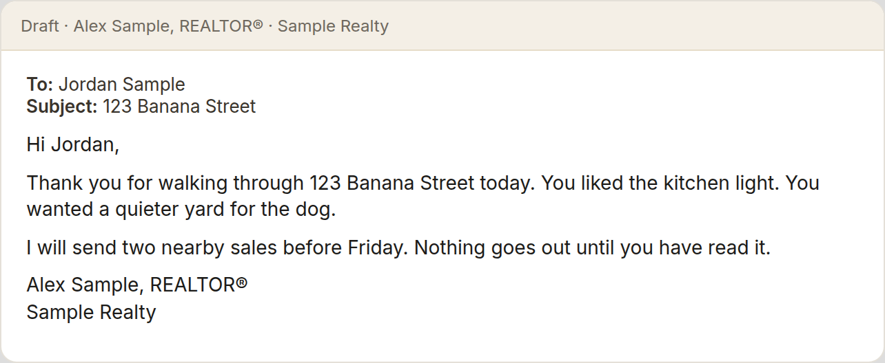
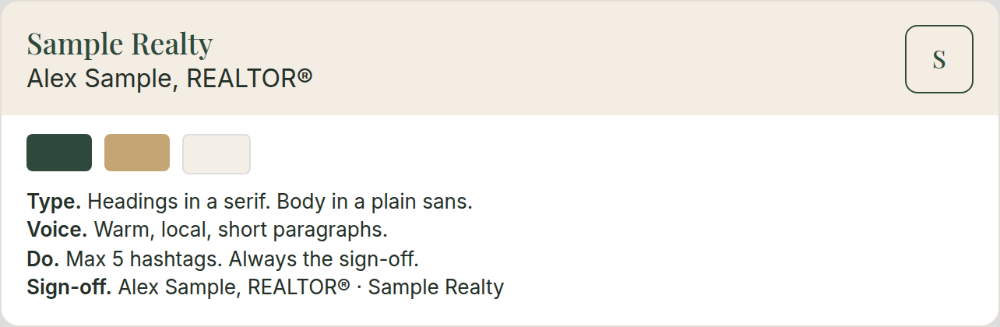
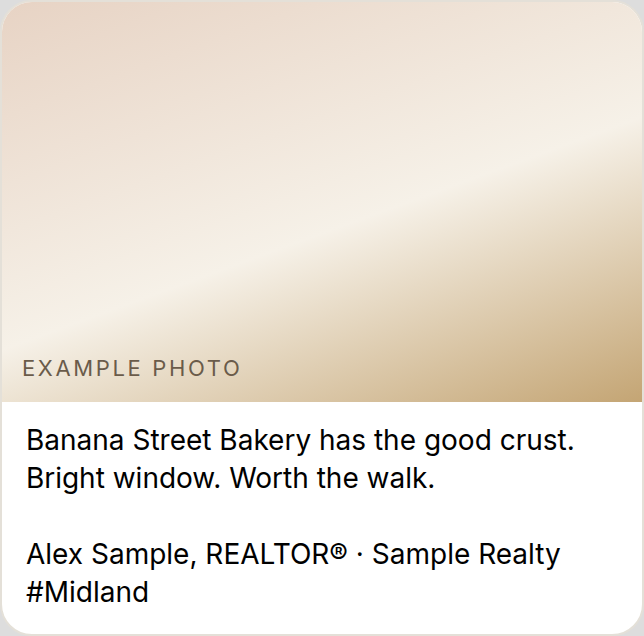
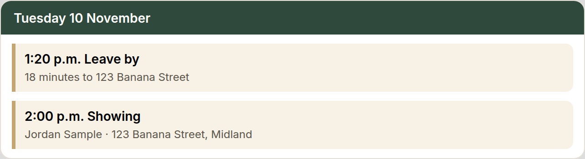
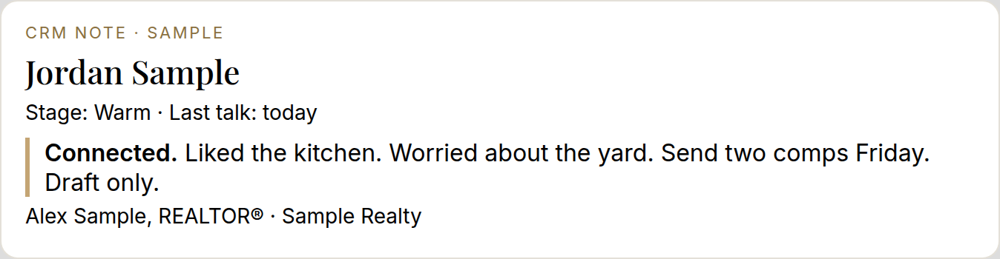
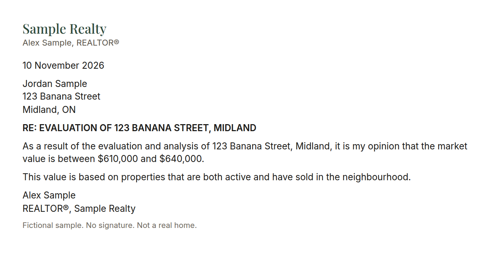
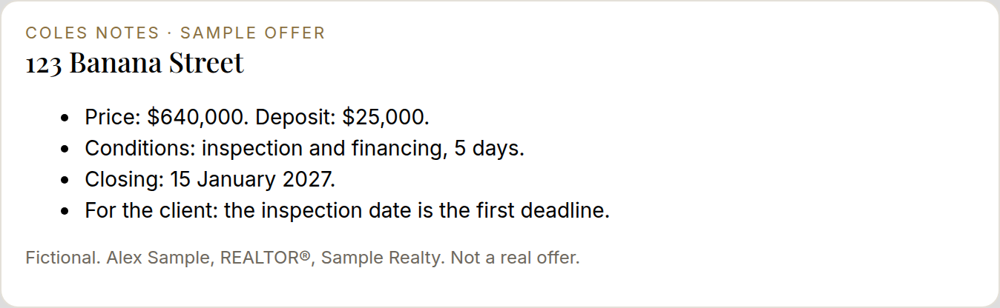
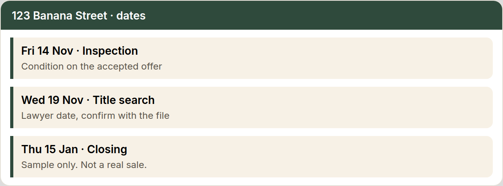
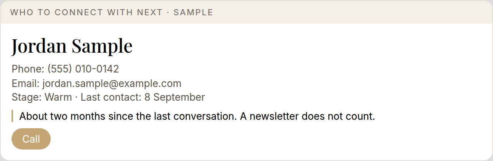

# 30-day checklist

Do one day at a time. If you don't finish a day's task, don't move on until it's done. If 30 days takes you 90, that's okay.

Eight parts, in order: Foundations, Clients and social, Connect your tools, Letters and offers, Deal card, Advanced, Your list, Review.

End every day by adding decisions to your decision log.

The first week covers your business, your writing style, brand guidelines, a task brain dump, dead leads, your decision log, and your inbox. Use Grok or Claude. Grok is the top pick for agents.

Your 30 days also live in an online learning centre where you sign in with your name and tick off each day.

| Done | Day | Task | Date done |
| --- | --- | --- | --- |
| [ ] | 1 | Use Grok or Claude on one real email. Grok is the top pick for agents. | |
| [ ] | 2 | Talk instead of type. Tip: save any prompt you reuse. | |
| [ ] | 3 | Brainstorm three tasks you hate. | |
| [ ] | 4 | About-me note: market, brokerage, who you serve, sign-off, contact details. | |
| [ ] | 5 | House rules. The approval line is rule one: it drafts, you approve. | |
| [ ] | 6 | Teach it your writing style. Share emails you have sent, plus authors and articles you like. Dictate a mock client email. Save an email writing SOP. Fix one thing you do not like and update the SOP. | |
| [ ] | 7 | Text templates: showing follow-up, offer update, check-in. Good spot to catch up. | |
| [ ] | 8 | Save your SOPs and decisions at the end of each chat. | |
| [ ] | 9 | Inbox cleanup: your 5 oldest unanswered emails, drafted for you to review and send. | |
| [ ] | 10 | Ask for reviews. Teach it where and how you ask, your review links, and your text and email templates. Send one text and one email to a client from a sale this year. | |
| [ ] | 11 | Share 10 posts you like. Copy each post link and say what you like. Have it make one new version for your business. | |
| [ ] | 12 | Pick your fonts and colours, and share examples of styles you like. | |
| [ ] | 13 | One Drive photo folder: headshots, listing photos, local spots, logo. Share only that folder. | |
| [ ] | 14 | Draft and save your brand guide. | |
| [ ] | 15 | First post. | |
| [ ] | 16 | Second and third posts. Schedule the third. Good spot to catch up. | |
| [ ] | 17 | Book appointments into your calendar by voice, with a leave-by reminder for drive time. | |
| [ ] | 18 | Teach it how you keep notes. Dictate a note and have it log to your CRM, such as Follow Up Boss, and the deal card. | |
| [ ] | 19 | Stay in touch with past clients. Dictate who they are, how you met, the last deal, their kids, and the house. It drafts an email, suggests follow-ups, and stores the details. | |
| [ ] | 20 | Listing descriptions and your top 5. Share your last 20 descriptions. Dictate a sample property. Save the finished top 5 as your template. | |
| [ ] | 21 | Letter of Opinion setup. | |
| [ ] | 22 | Letter of Opinion: practice on a past deal, then a real one, timed. | |
| [ ] | 23 | Read an offer. Teach it the agreement of purchase and sale, mock signbacks, the Confirmation of Acceptance, and what is relevant for a client. Do one mock and email the Coles Notes to yourself. | |
| [ ] | 24 | Deal deadline tracker. From an accepted agreement, add condition dates, the title search date, and closing to your calendar. Good spot to catch up. | |
| [ ] | 25 | Deal card setup. Sign in yourself. | |
| [ ] | 26 | Deal card on 10 leads. Make the calls. | |
| [ ] | 27 | Paste the notes back. Run the next 10. Tip: three times a week. | |
| [ ] | 28 | Prep your listing appointment paperwork. A blank RECO guide and listing agreement, with your standard Schedule A, as editable PDF masters from WEBForms, and your standard terms filled in. Pull owner details from GeoWarehouse and the postal code from Google. Every PDF in one minute. | |
| [ ] | 29 | Book showings in BrokerBay. Your windows, a Google Maps route check, book a mock showing, draft the client note, and how to cancel. | |
| [ ] | 30 | Month review. Clean up your rules file. Pick what is next for Step 2. | |

By day 30: a rules file, saved prompts, the Letter of Opinion working, a deal card habit, a brand guide, and three posts out.

The printable copies show a small example beside the days where a picture helps. Every example is Sample Realty, Alex Sample, REALTOR®, and 123 Banana Street. Not a real home.

